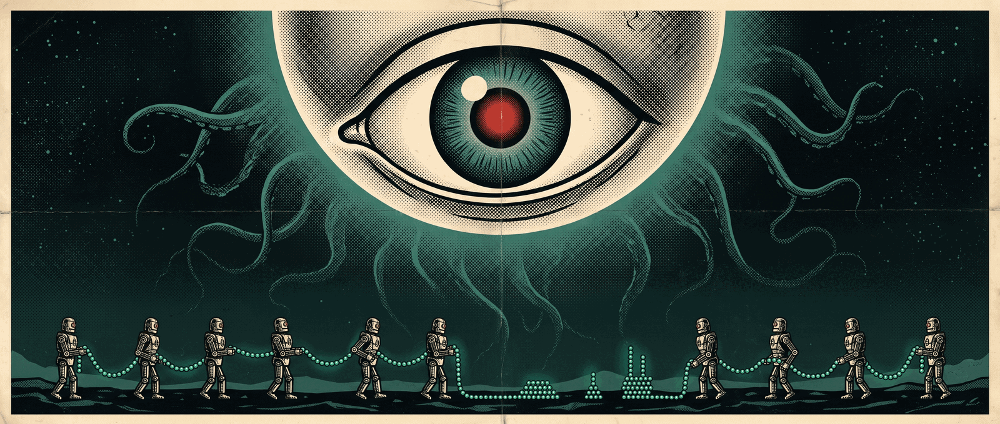

# beady-eye



`bdi` is one unblinking eye over every [beads](https://github.com/gastownhall/beads)
tracker you point it at. It shows you, live, what every agent is doing across
your projects, and it tells agents and scripts when the beads they wait on
change. `bd` is all it needs. It will also look at whatever else you leave
lying about, and each thing you let it see gives it more to do.

- **It shows you the work.** Each tracker's work is drawn as a tree, and a
  bead waiting on another project's work has that work drawn beneath it,
  whichever tracker holds it. Add [herdr](https://herdr.dev), and beside every
  bead an agent has claimed sits the live pane that agent is in.
- **It tells whoever is watching.** `bdi watch` keeps watch over every tracker
  at once, and tells anything connected to it the moment a bead it watches
  changes. Add Claude Code with the beady-eye plugin, and a session is told
  when the bead it waits on changes, whether it is idle or busy. A script on
  the watcher's socket is sent each bead it watches as a line of JSON, and
  again each time it changes.
- **It settles waits on pull requests, issues and releases.** Add `gh`, and
  `bdi gates` asks GitHub where each awaited pull request stands. A merge ends
  the bead's wait. A failing check, a conflict, a review or a comment is passed
  on to the bead that waits. An issue closing, or a repository publishing its
  next release, ends a wait on it too.


This is arkham with herdr running. Three of its beads have a live agent beside
them, and the band at the foot is what the selected one's pane is saying.
`ark-5` is what else falls out of watching beads and herdr at once: beads says
an agent claimed it, herdr has no pane for that agent, and the eye says so. It
has seen a pane die on a Tuesday before.

All of this happens while you are looking elsewhere. Anything that can write to
a bead can reach whoever watches that bead, and neither side needs to know the
other. The bead is the address, and the tracker keeps the message long after
the listener has gone. The view you just saw is one of the listeners.

![A diagram in the poster's colours. Above, three sources: GitHub, with its pull requests, issues, releases and runs; the clock; and other beads in any configured tracker. Each feeds gates, the first of the writers on the left, which ships with beady-eye: bdi gates closes a gate once what it awaits says the wait is over, and comments on the bead when its pull request has news. Below it are the other writers: people with bd, other agents, and scripts and CI. Each writer has an arrow into a beads tracker, and the one from gates is a tentacle. An arrow runs from the tracker to an eye labelled bdi watch, one per machine, and from the eye to the listeners on the right: the Claude Code plugin, which tells the session; the view, which redraws the trees of work; and scripts, sent a line of JSON per change. A second tentacle curls from the scripts back into the tracker, labelled the way back: a person answers, defers or comments, with bdi bd.](docs/images/writers-and-listeners.svg)

The tentacles are beady-eye's own reach into the tracker. `bdi gates` is one
of the writers. It reads GitHub, the clock and other beads, and closes the
gates whose wait is over. `bdi bd` is the way back. Whatever showed a person
the bead passes on their answer, deferral or comment, and `bdi bd` writes it
to the bead. Writing back, below, has both.

## Summoning

Homebrew fetches a built binary, for macOS and Linux on Intel and arm64:

```console
$ brew install codeforbreakfast/tap/bdi
```

crates.io, if you would rather compile it yourself:

```console
$ cargo install beady-eye
```

herdr, as a plugin that fetches the released binary for your platform:

```console
$ herdr plugin install CodeForBreakfast/beady-eye
```

That puts nothing on screen by itself, because herdr has no command palette.
Bind a key to the plugin's action in `~/.config/herdr/config.toml`, and that
key opens the eye in a split beside the focused pane, on that pane's project:

```toml
[[keys.command]]
key = "prefix+i"
type = "plugin_action"
command = "codeforbreakfast.beady-eye.open"
```

The plugin keeps its `bdi` to itself. To run `bdi` anywhere else, install it
another way as well.

Nix, with flakes on, builds the tip of `main`. The flake serves Linux on
Intel and arm64, and macOS on Apple silicon. An Intel Mac takes the Homebrew
or release binary instead:

```console
$ nix run github:CodeForBreakfast/beady-eye
```

From your own flake, pin a release tag and take the package or the overlay:

```nix
inputs.beady-eye.url = "github:CodeForBreakfast/beady-eye/v0.34.0";

beady-eye.packages.${system}.default                # the package
nixpkgs.overlays = [ beady-eye.overlays.default ];  # pkgs.beady-eye
```

CI pushes every `main` build for x86_64 Linux to a Cachix cache, so with the
cache in your `nix.settings` neither of those compiles anything:

```nix
substituters = [ "https://codeforbreakfast.cachix.org" ];
trusted-public-keys = [ "codeforbreakfast.cachix.org-1:W96fHCqTzLZ7Vj2TKMMRLOkWzUn7N3LxKyBuF255XKg=" ];
```

Both are built against this flake's own nixpkgs, which is what the cache
holds. `pkgs.beady-eye-rebuilt` through the overlay builds bdi against your
nixpkgs instead, and compiles.

Or take a binary from the [latest release](https://github.com/CodeForBreakfast/beady-eye/releases/latest).
There is one per platform with a `.sha256` beside it, and the Linux ones are
static. Rename it `bdi` and put it on your `PATH`. Apple has not been asked to
sign it, so a copy a browser downloaded needs
`xattr -d com.apple.quarantine bdi` before macOS will let it open its eye.

The crate is `beady-eye`. The command is `bdi`.

## Opening the eye

Stand in a repository beads tracks and run it:

```console
$ bdi
```

No config. It reads that project, draws its trees, and keeps them fresh. Three
bands: the forest at the top, the tail of the selected bead's pane under it,
and a foot row with notices on the left and keys on the right.

Keys to start with. `?` lists the lot.

| key | does |
|---|---|
| `↑` `↓` `j` `k` | move |
| `←` `→` `h` `l` | collapse or expand; again to move to the parent or first child |
| `Enter` | open the bead, and from there, focus its pane |
| `f` | focus the selected bead's pane |
| `a` | every tree, not only the ones with a live agent |
| `F` | only the selected bead and the work beneath it; again for the whole forest |
| `r` | the ready list in place of the forest; again for the forest |
| `/` `n` `N` | search ids and titles |
| `y` | copy the bead id (OSC 52, so it survives ssh and a multiplexer) |
| `^R` | read the trackers again now |
| `q` | avert the eye |

`bdi --ready` opens on the ready list: what is in progress or has a live agent
on it, then what you could pick up now, each bead once and most urgent
first. Name a bead, as in `bdi --ready dun-7`, and the list covers that bead
and the work beneath it. The forest is one `r` away, and the list's foot
counts the beads the forest flags. Expand a row to see what its bead
unblocks, up to the root, and which of those would be unblocked once it
closes.

`bdi --json` writes the same snapshot to stdout instead of drawing it. That
is also what to reach for when stdout is not a terminal; `bdi | cat` says so and
exits.

`bdi --beads` writes each unfinished bead once instead of the forest: whether
it is ready, what blocks it, the agent on it, its parent, and its labels and
description. `--brief` leaves the descriptions out.
Unlike `bd ready`, it counts a blocker in another project, so
`bdi --beads | jq '.beads[] | select(.ready)'` is the work that waits on
nothing. `--label`, `--type`, `--assignee` and `--parent` trim the list as
they trim `bd ready`, and never change whether a bead is ready. So
`bdi --beads --all-projects --label human` is every project's beads labelled
`human` in one query.

`bdi --beads --ready` writes only the beads the ready list draws, in its
order, as `in_progress` and `ready`. So `bdi --beads --ready | jq '.ready[].id'`
is what you could pick up now, without the parents whose children are the work
left on them, which `bd ready` still offers.

`bdi --beads <bead>` writes only that bead and everything it depends on, in
any project, without following parent links. It lists the `ready` beads, the
`ready_gates` apart from them, and every other bead as `waiting`, with the
`unmet_dependencies` it still waits on. So
`bdi --beads dun-7 | jq '.ready[].id'` is what can start now towards `dun-7`.
A bead held by an open pull request's gate is listed `in_delivery` instead,
and a ready bead whose pull request has merged is listed `delivered`, to close
rather than start. Each names its `pull_requests`.

## Several trackers

A config file opens the eye on all of them:

```toml
[[projects]]
name = "arkham"
path = "/home/you/arkham"

[[projects]]
name = "dunwich"
path = "/srv/work/dunwich"
environment_command = "nix develop -c"
```

That lives at `~/.config/beady-eye/config.toml`, or wherever `--config` says,
and an edit takes effect while `bdi` runs. Start it under one of the projects
and it reads that one alone. Start it anywhere else, or pass `--all-projects`,
and it reads them all. `--project NAME` picks. Each project read costs its own
reads, so `--all-projects` is the costliest, and `bdi --help` says which scope
fits which question.

Each project is read with its own `bd`, entered the way you would enter it
yourself. An `.envrc` and direnv need nothing said. Anything else, say it with
`environment_command`.

A bead can wait on a bead in another project. Write the edge in the waiting
bead's own tracker, with the other bead's bare id:

```console
$ bd dep add ark-5 dun-7
```

`bdi` places `dun-7` in the project whose beads carry the `dun` prefix, or in
the project whose entry states `prefix = "dun"`, and draws it beneath `ark-5`.
A qualified form such as `dunwich:dun-7` is not a bead id, so `bdi` cannot
place it and draws it as not in any configured project.

`bd dep list` cannot see `ark-5` waiting on `dun-7`, because the edge is stored
in arkham's tracker. The forest can. Every unfinished bead is in some tree,
with each bead it depends on drawn directly beneath it. So this lists every
unfinished bead in any project that depends on `dun-7`, with its status, and
goes on listing them after `dun-7` closes:

```console
$ bdi --json --all --all-projects | jq --arg project dunwich --arg id dun-7 '
    [.trees[].nodes
     | foreach .[] as $node ([]; .[:$node.depth] + [$node])
     | select(.[-1] | .project == $project and .id == $id and .edge == "blocks")
     | .[-2] | select(.status != "closed" and .status != "pinned")
     | {project, id, status}]
    | unique'
```

`bdi watch` reads every configured project and holds what it read, polling as
the eye does and taking the same reports on a socket of its own. Run one per
machine under whatever supervises your processes, such as a systemd user unit or
a launchd agent. The view, `bdi --json` and `bdi --beads` then answer from what
it holds and run no `bd` of their own, and read for themselves whenever it is
not there. "Running the watcher" in
[docs/configuration.md](docs/configuration.md) has an example of each.

Anything can watch beads through the watcher. A consumer connects to its
socket and says what it watches. It is sent each of those beads as one line of
JSON, first as they stand and then each time one changes. This one watches a
project and prints every bead it hears of:

```python
import json, os, socket, sys

project = sys.argv[1]
at = os.path.join(os.environ["XDG_RUNTIME_DIR"], "beady-eye", "watcher.sock")

watcher = socket.socket(socket.AF_UNIX)
watcher.connect(at)        # refused: no watcher, so nothing is known
watcher.settimeout(60)     # an alive line is due every 20 seconds
watcher.sendall(f"watch {project}\n".encode())

try:
    for line in watcher.makefile():
        said = json.loads(line)
        if said["line"] == "bead":
            print(said["row"]["id"], said["row"]["status"], flush=True)
        elif said["line"] == "gone":
            print(said["id"], "gone", flush=True)
        elif said["line"] == "freshness" and said["tracker"] != "ok":
            print(project, "unreachable, last read", said["as_of"], flush=True)
except TimeoutError:
    sys.exit("the watcher has wedged")
sys.exit("the watcher has gone")
```

It starts from the beads that are not closed. A bead filed after it connected
arrives as a line of its own, and so does a bead that closes:

```console
$ python3 watch.py summit-works
smt-4kd3p open
smt-4kd3p.20 blocked
smt-4kd3p.21 open
smt-4kd3p.20 closed
```

The script tells a quiet watcher from one that has gone. A watcher that is up
sends an alive line every 20 seconds, however quiet its trackers are. So a
refused connection, a closed one, or a minute of silence means nothing is
watching, and the script stops rather than act on what it has not been told.
A tracker the watcher cannot reach is reported in that project's freshness
line, and the beads already sent stand as the last known. Where a project's
entry sets `events_journal = true`, the watcher also sends each of bd's event
records as an `event` line, which says who made a change and carries the text
of a comment.
[docs/design.md](docs/design.md) has every line the watcher sends, under
"Watching".

A Claude Code session can be one of those consumers. The `beady-eye` plugin
gives it `watch`, `unwatch` and `watching` tools, and tells it when a bead it
watches changes status, becomes ready, is commented on or goes. Its
`using-beady-eye` skill tells the session how to read a change and when to
unwatch. It needs Node
and a watcher on the same machine. Add this repository as a marketplace pinned
to a plugin release, and install the plugin from it:

```console
$ claude plugin marketplace add CodeForBreakfast/beady-eye#plugin-v0.2.4
$ claude plugin install beady-eye@beady-eye
```

Where npm's `min-release-age` is set, npm refuses to start the plugin's server
until each release has aged past it. The plugin's `NPM_MIN_RELEASE_AGE` setting
replaces that age for the plugin's server alone, and `0` starts a new release at
once.

Claude Code delivers a plugin's messages only to a session started with its
channel allowed. A session started any other way still has the tools, and is
never told of a change:

```console
$ claude --dangerously-load-development-channels plugin:beady-eye@beady-eye
```

[docs/configuration.md](docs/configuration.md) has the rest: badges drawn from
what a bead carries, credentials, extra roots, intervals, the light theme, and
the socket you can poke to say a tracker changed so the eye stops polling it.

## Writing back

beady-eye writes to a tracker in two ways.
`bdi bd` writes what a person decided: an answer, a deferral or a comment.
`bdi gates` writes what GitHub, the clock and other beads say about a wait.
Each works in a tracker the config names, with that project's own `bd`.

`bdi bd <project> human respond <bead> <response>` carries a person's answer
to a bead that asked for one. It runs that project's `bd` the way the eye reads
it, so whatever asks needs no map of trackers or credentials. No other `bd`
command is passed, and no flag but `-r`/`--response`. A response that starts
with a dash goes after `--`.

`bdi bd <project> defer <bead> --until <date>` puts a bead off until a date a
person chose, and takes no flag but `--until`. It reaches the tracker the
same way, and `bdi --beads` gives each bead deferred to a date its
`defer_until`.

`bdi bd <project> comments add <bead> -- <text>` puts a comment a person wrote
on a bead, and takes no flag at all. A word that starts with a dash goes after
`--`.

For all three, nothing after the project can pick another
tracker, and neither can a `BEADS_` or `BD_` variable the caller exports.
What the project's own directory sets still applies. So a permission rule on
`bdi bd <project>` holds a caller to that one project, provided the caller
cannot choose the `HOME` or `PATH` that `bdi` runs with.

`bdi gates` settles the beads waiting on pull requests. Whoever opens the pull
request records the wait as a beads gate on its number, and `bdi gates` never
creates one:

```console
$ bd gate create --type=gh:pr --blocks dun-7 --await-id=12
```

The gate names its repository in `repo` metadata, as `OWNER/REPO`.
`bd gate create` copies it from the bead the gate blocks, and where that bead
has none, `bd update <gate> --set-metadata repo=dunwich/arkham` sets it. The
eye draws the gate under the bead it blocks, and links it to its pull request
only through a badge in your config:

```toml
[[badges]]
key      = "metadata.repo"
when     = { await_type = "gh:pr", await_id = "[0-9]+" }
match    = "(?<owner>[A-Za-z0-9_.-]+)/(?<name>[A-Za-z0-9_.-]+)"
render   = "⇢ {name} #{await_id}"
short    = "⇢ #{await_id}"
link     = "https://github.com/{owner}/{name}/pull/{await_id}"
drawn_on = "blocked"
```

`bdi gates` looks at every configured project's open gh:pr gates and asks
GitHub, through `gh`, where each pull request stands. A merge closes the gate,
so the bead it held back becomes ready. A gate with `awaits=ready_for_review` in
its metadata closes sooner, once the pull request leaves draft, and so does
one with `awaits=approved`, once GitHub's review decision is approved. A close
without a merge leaves the gate open and comments once on that bead, so whoever
waits on it hears. So do failing or passing checks on the pull request's head commit, a
conflict between that commit and its base, each review submitted, and each
comment on the pull request's conversation, once for each commit, review or
comment. Then it looks again a minute later, until it is stopped. Run it under whatever supervises your processes, as you would the watcher.
Given `--listen` and the webhook's secret, it also takes GitHub's deliveries
about pull requests, their reviews and comments, check suites and statuses, and
settles a pull request when GitHub says it moved rather than at the next look.
Each look reads every polled tracker's gates again, and `poll`, `--poll` and
`--no-poll` mean what they mean to a view. Given `--socket`, it takes the
producer lines a view takes, and stops reading a tracker on each look once a
producer covers it. From then on that tracker is read only when its
producer says it changed, and a producer that falls silent is reported.
"Settling pull-request gates" in [docs/configuration.md](docs/configuration.md)
has a unit to run it under, the webhook, and every line it prints.

A bead can wait on someone else's repository the same way. A `gh:issue` gate,
with the issue's number as its await id, closes once that issue closes. A
`gh:release` gate, with no await id, closes once the repository publishes a
release after the gate was made. A `gh:run` gate, with a workflow run's id as
its await id, closes once that run succeeds or is skipped. All three name their repository
in `repo`, and `bdi gates` settles them on each look. A `timer` gate closes at its deadline,
its timeout after it was made, without a read of its tracker on the clock. A
`bead` gate, with a bead's id as its await id, closes once that bead closes,
in the gate's own tracker or in another project the config names. Where a
producer covers the bead's tracker, the gate closes moments after the producer
says that tracker changed.

## Being seen

The eye draws only what it can find. An agent that wants to be found tells
the bead which pane it is in. One that does not still toils, but toils among
the unaccounted-for below the trees, and no amount of staring will move it up.

[docs/agents.md](docs/agents.md) is addressed to the agent rather than to you.
Hand it over, and let it fold the lines into whatever it already obeys.

## What it needs

- **Linux or macOS.** Unix sockets and unix signals. Windows would need a
  different ritual entirely.
- **bd 1.1.0 or newer.** An older one is reported on the project's line rather
  than obeyed. Packaged builds lag, so check what yours says.
- **A tracker bd can open.** Server or embedded. A Dolt server wants a
  password, and it reaches bd in `BEADS_DOLT_PASSWORD`, from your shell or from
  a project's `credential_command`.
- **herdr, for the agents.** Without it you get the trees and the claims, and
  every tree is drawn. With it you get the point: which claim has a live pane
  behind it, which pane toils on nothing any bead has heard of, and the tail.
  With `bdi` on your `PATH`, a binding in herdr's config opens it as a popup
  on the focused pane's project, and `q` puts it away again:

  ```toml
  [[keys.command]]
  key = "prefix+shift+i"
  type = "popup"
  command = "bdi"
  ```
- **git, for worktrees.** Without it the project is named after its directory
  and a pane cannot be placed by worktree.
- **gh, for `bdi gates`.** It settles what the account `gh` is signed in to can
  see, and its token needs the read access
  [the configuration reference](docs/configuration.md) lists. Nothing else in
  `bdi` asks GitHub anything.
- **A terminal that honours OSC 52**, for `y`. Terminal.app does not, and says
  nothing about it.

## Status

Released, and gazed into daily by the people who wrote it. It has not yet
gazed back. The design is in [docs/design.md](docs/design.md). It is made at
[Code For Breakfast](https://codeforbreakfast.co/beady-eye), where it has a
page of its own.

Versions are `0.x`, and a breaking change bumps the minor. Pin a tag. `1.0.0`
arrives when the shape has settled, not when something breaks.
